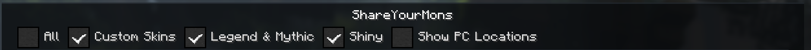
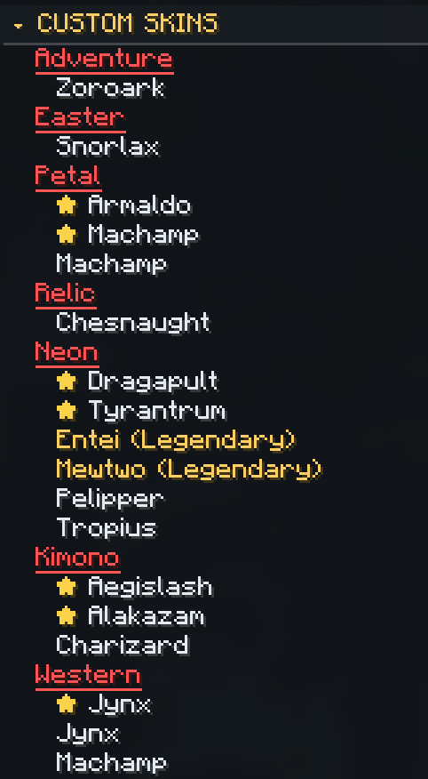
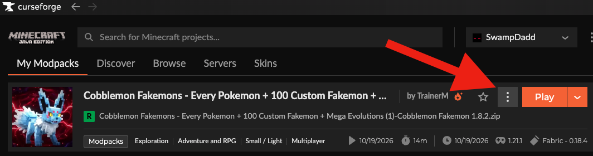
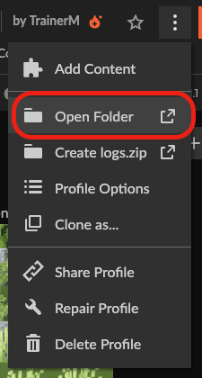
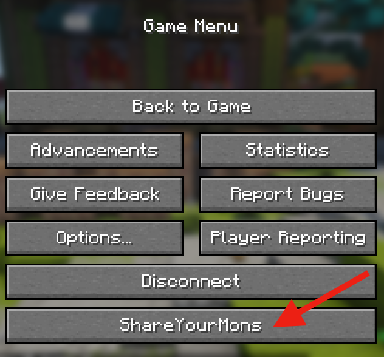
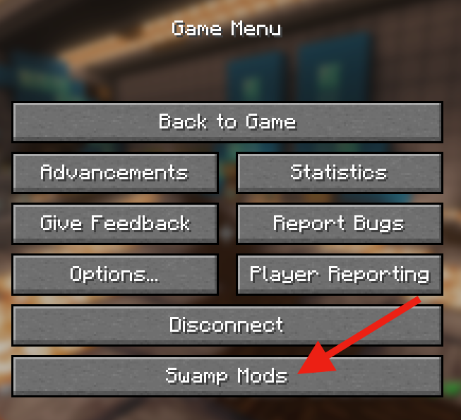

# ShareYourMons

**Your Cobblemon collection, all in one place.**

ShareYourMons is a client-side Minecraft mod for Cobblemon Town and the Cobblemon Optimized: Your Pokémon Journey modpack.

It helps you find the Pokémon you care about without opening every PC box. Browse custom skins, Legendary and Mythical Pokémon, and shinies; see where each Pokémon is stored; or copy a collection report to share with friends.

<table>
<tr>
<td width="40%" valign="top">

</td>
<td valign="top">

**What you can do**

* **Find custom skins.** Browse recognized Cobblemon Town skin collections in one place.
* **Find Legendary and Mythical Pokémon.** See them together in an organized view.
* **Find shinies.** Check your whole PC without opening every box.
* **Locate Pokémon.** Turn on PC locations to see the box and slot where each Pokémon is stored.
* **Share your collection.** Copy a readable report and paste it wherever you like.

ShareYourMons is client-side only. It reads PC information Cobblemon has already synchronized to your game and never changes your Pokémon. Open it from the Escape menu after installing the JAR.

</td>
</tr>
</table>

## Download & Install

[**Download ShareYourMons (.jar)**](https://github.com/SwampDad/shareyourmons/releases/latest/download/shareyourmons.jar)

This is the permanent download link for the current stable release, 0.3.1.

### Install with CurseForge

1. Open CurseForge and go to **My Modpacks**.
2. Find the Cobblemon modpack and click its three-dot menu.

   

3. Select **Open Folder**.

   

4. Open the **mods** folder.
5. Place the [**ShareYourMons JAR**](https://github.com/SwampDad/shareyourmons/releases/latest/download/shareyourmons.jar) inside.
6. Remove any older ShareYourMons or Collection Exporter JAR.
7. Launch the modpack normally.

Install only one copy of ShareYourMons.

### Open ShareYourMons in Minecraft

<table>
<tr>
<td width="50%" valign="top">
<strong>Only ShareYourMons installed</strong> 
 
Press <strong>Esc</strong> and select <strong>ShareYourMons</strong>.
</td>
<td width="50%" valign="top">
<strong>Multiple Swamp Mods installed</strong> 
 
Press <strong>Esc</strong>, select <strong>Swamp Mods</strong>, then select <strong>ShareYourMons</strong>.
</td>
</tr>
</table>

These are alternative menu configurations, not sequential steps.

## Current Features

* **Custom Skins** groups recognized Cobblemon Town skins by collection.
* **Legend & Mythic** collects Legendary and Mythical Pokémon.
* **Shiny** finds shiny Pokémon across your PC.
* **All** shows every Pokémon in your PC.
* **Show PC Locations** adds the stored box and slot for each entry.
* **Copy to Clipboard** creates a readable report of your selected categories.
* **Refresh** updates the view from the PC information available to your game.
* Unfamiliar or conflicting skin information stays visible under Unresolved instead of being guessed.

## How to Use

The filters at the top of the screen work together. A Pokémon is included when it matches any selected category.

* **All:** every Pokémon in your PC.
* **Custom Skins:** recognized Cobblemon Town skin collections.
* **Legend & Mythic:** Legendary and Mythical Pokémon.
* **Shiny:** shiny Pokémon.
* **Show PC Locations:** display box and slot information.

Use **Copy to Clipboard** when you want to share the current report. The copied text uses the categories and location setting currently selected.

ShareYourMons does not yet provide individual Pokémon selection or one-click sharing directly into Minecraft chat.

## How Classification Works

ShareYourMons uses a reviewed catalog of documented Cobblemon Town skin identifiers. It compares those identifiers with the appearance information Cobblemon exposes to the client.

When information is unfamiliar or conflicting, the mod keeps it visible as unresolved instead of assigning a guess. Legendary and Mythical categories come from Cobblemon species information.

The catalog is based on reviewed information, not an official live server registry. Server content can change.

Read the full research: [How ShareYourMons Recognizes Cobblemon Town Skins](docs/research/how-shareyourmons-recognizes-skins.md)

## Possible Upcoming Features

These are ideas being explored, not promised features or release dates:

* **Advanced IV filtering.** Find 5x31 and 6x31 Pokémon more easily.
* **Ability display and Hidden Ability identification.** See ability information in the collection view.
* **Alpha Pokémon identification.** Mark Alpha Pokémon clearly.
* **Pokédex integration.** Connect collection browsing with Pokédex progress.
* **Live Touch Trade Finder.** Help players find touch trades for Pokédex completion.
* **Better PC browsing.** Add clearer filtered list views.
* **Improved individual and multiple-Pokémon sharing.** Make it easier to share one Pokémon or a small group.

Tell me which of these would help you most through the Cobblemon Town Discord or GitHub Issues.

## Requirements

| Component | Supported target |
| --- | --- |
| Minecraft | 1.21.1 |
| Mod loader | Fabric |
| Fabric Loader | 0.18.0 or newer |
| Fabric API | 0.116.7+1.21.1 or newer |
| Cobblemon | 1.8.2 |
| Java | 21 or newer |
| Modpack | Cobblemon Optimized: Your Pokémon Journey |
| Installation | Client only |

Other Minecraft versions, Cobblemon versions, and modpacks have not been verified as compatible.

You do not need PC Plus or PC Exporter.

## Privacy

ShareYourMons runs on your Minecraft client.

It reads PC information Cobblemon has already synchronized to your game. It does not change your Pokémon or PC storage, run server commands, upload collection information, collect telemetry, or export files.

Copying a report only happens when you choose to use **Copy to Clipboard**. You decide where to paste it.

## Troubleshooting

### I can’t find ShareYourMons in the Escape menu

* Check that the ShareYourMons JAR is in the mods folder for the profile you are launching.
* Check that Minecraft 1.21.1, Fabric, Cobblemon, and the required dependencies are installed.
* Remove any duplicate ShareYourMons JAR or old Collection Exporter JAR.
* If other Swamp Mods are installed, look for the **Swamp Mods** menu.

### My PC collection looks incomplete

ShareYourMons reads the PC information currently synchronized to your client. That information can be incomplete, outdated, or unavailable. Try refreshing after your game has synchronized your PC information.

### A custom skin isn’t recognized

The catalog uses reviewed identifiers. An unfamiliar skin may stay under Unresolved rather than being assigned an incorrect collection.

If you report it, include the species, form, and any relevant appearance information.

### My copied report is too long

Try narrowing the filters or turning off PC locations before copying. The place where you paste the report may also have a message-length limit.

## Recent Updates

### 0.3.1 — ShareYourMons

Collection Exporter became ShareYourMons, with updated in-game branding and version information. This was primarily a branding release.

### 0.3.0 — Collection Viewer

The first stable collection viewer introduced custom-skin recognition, Legendary and Mythical filtering, shiny filtering, PC box and slot locations, clipboard reports, and in-game collection browsing.

Development work is not included in the current stable download until it has been approved for release.

[View the full changelog](CHANGELOG.md)

## Questions, Bugs & Suggestions

You can reach me in two ways:

* Message **SwampDad** on the official Cobblemon Town Discord server.
* [Open a GitHub issue](https://github.com/SwampDad/shareyourmons/issues) if you use GitHub.

You do not need a GitHub account to ask for help on Discord.

Please include the ShareYourMons version and a brief description of the problem. For skin recognition issues, include the Pokémon species, form, and relevant appearance information.

Please do not post complete private PC reports, player identifiers, or other players’ collection data.

## Documentation

* [How ShareYourMons Recognizes Cobblemon Town Skins](docs/research/how-shareyourmons-recognizes-skins.md)
* [Classification and developer reference](docs/classification.md)
* [Documentation index](docs/README.md)
* [Full changelog](CHANGELOG.md)
* [Roadmap](ROADMAP.md)
* [Release history](release/README.md)
* [Attribution and notices](NOTICE.md)

## Licensing and Attribution

ShareYourMons is an independent community project by SwampDad. It is not an official release of, or endorsed by, Cobblemon, Cobblemon Town, Mojang, Microsoft, or Fabric.

ShareYourMons is open source under the [MIT License](LICENSE).

See [LICENSE](LICENSE) and [NOTICE.md](NOTICE.md) for licensing and attribution.
